<p align="center">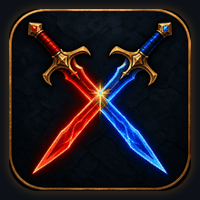</p>

# PvMP+ Revisited

**Seguimiento completo de tu progreso en JcJ (PvMP) en las Landas de Etten**, en español o inglés. Incluye avisos de asedio compartidos, pedido de ayuda con tu posición en el mapa, temporizador del jefe Gaergoth y un aspecto moderno con auras y llamas animadas.

Está basado en **PvMP+ 4.3.2 de Urundus**: conserva todas sus funciones originales y añade traducción al español, corrección de errores y las funciones nuevas descritas abajo.

> Las animaciones de este README son recreaciones hechas con los gráficos reales del addon. El mapa del GIF de ayuda es ilustrativo: en el juego, el plugin usa el mapa de las Landas de Etten del propio juego.

---

## Índice

1. [Barra principal: rango, renombre/infamia y menciones](#1-barra-principal-rango-renombreinfamia-y-menciones)
2. [Fortalezas, puestos y mejoras con auras](#2-fortalezas-puestos-y-mejoras-con-auras)
3. [Ventana de Asedios: avisar que están tomando una fortaleza](#3-ventana-de-asedios-avisar-que-están-tomando-una-fortaleza)
4. [Botón Help!: pedir ayuda con tu posición en el mapa](#4-botón-help-pedir-ayuda-con-tu-posición-en-el-mapa)
5. [Gaergoth the Unbound: icono con llamas y temporizador](#5-gaergoth-the-unbound-icono-con-llamas-y-temporizador)
6. [Ventana de estadísticas](#6-ventana-de-estadísticas)
7. [Avisos, últimas bajas, golpes recientes y mapa](#7-avisos-últimas-bajas-golpes-recientes-y-mapa)
8. [Idioma español / inglés](#8-idioma-español--inglés)
9. [Iconos y gráficos](#9-iconos-y-gráficos)
10. [Novedades: barra animada, marcos, temas, rachas y más](#10-novedades-barra-animada-marcos-temas-rachas-y-más)
11. [Comandos del chat](#comandos-del-chat)
12. [Opciones y guardado](#opciones-y-guardado)
13. [Instalación](#instalación)
14. [Requisitos, limitaciones y créditos](#requisitos-limitaciones-y-créditos)

---

## 1. Barra principal: rango, renombre/infamia y menciones

La barra principal muestra:

- **Tu progreso hacia el siguiente rango**, con porcentaje y número de rango.
- **Tu renombre** (Pueblos Libres) **o infamia** (Monstruos): total o lo que falta para subir de rango. Haz clic en el texto para cambiar de uno a otro.
- **Tus menciones** (*commendations*).

El plugin lee el chat del juego y suma automáticamente:

- Puntos ganados.
- Menciones.
- Golpes mortales.
- Muertes.
- Veces que te rastrean.

Cada golpe mortal tuyo muestra un aviso en pantalla, por ejemplo *"Tu golpe mortal derriba a X! Bazinga!"*.

- **Barras modernas:** azul para los Pueblos Libres y rojo para los Monstruos, con degradado, brillo arriba y bordes redondeados.
- **Estadísticas rápidas** (se pueden ocultar): hoy, mes, hora, últimos 10 minutos y último combate.
- **Botón de chat:** envía tus estadísticas a un canal. Con clic derecho eliges qué datos se envían.
- **Tamaño:** el ancho de la barra se ajusta en **Opciones → Tamaño de la barra**.

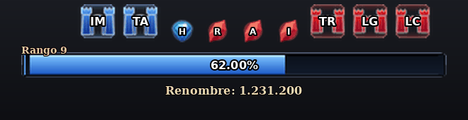

---

## 2. Fortalezas, puestos y mejoras con auras

Encima de la barra aparecen las **5 fortalezas** como **castillos** con sus siglas, y en el centro los **4 puestos avanzados** como **diamantes** más pequeños:

| Sigla | Fortaleza |
|---|---|
| TA | Tol Ascarnen |
| IM | Isendeep Mine |
| TR | Tírith Rhaw |
| LG | Lugazag |
| LC | Grimwood Lumber Camp |

| Letra | Puesto avanzado |
|---|---|
| H | Coldfells Outpost |
| R | River Outpost |
| A | Arador's End Outpost |
| I | Isendeep Outpost |

- **Bando de cada fortaleza:** las del lado izquierdo son de los Pueblos Libres (castillo azul) y las del derecho de los Monstruos (castillo rojo). El plugin lo sabe por las bonificaciones que tiene tu personaje, sin que hagas nada.
- **Bando de cada puesto avanzado:** diamante azul para los Pueblos Libres y cristal rojo para los Monstruos.
- **Mejoras de bando:** también se muestran las mejoras (árbol, Gary, draco, Carrock, corona, inferioridad numérica), con el tiempo que lleva cada bando con ellas.
- **Auras estilo LUI:** cada icono tiene un borde brillante del color de su bando. Cuando una fortaleza cambia de dueño o un bando gana una mejora, su aura **late 8 segundos** y luego queda suave. Al entrar al juego no late nada, para no molestar.
- **Encender o apagar las auras:** `/pvmp+ auras off` / `/pvmp+ auras on`. La elección se guarda para toda la cuenta.

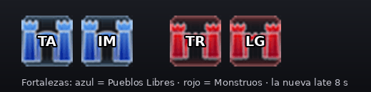

---

## 3. Ventana de Asedios: avisar que están tomando una fortaleza

Ábrela con `/pvmp+ asedios`. Tiene un botón por fortaleza (TA, IM, TR, LG, LC), un botón más pequeño por puesto avanzado (H, R, A, I) y el botón **Help!**.

**Al hacer clic en una fortaleza o un puesto**, el plugin envía automáticamente por el canal **OOC**, siempre en inglés para que lo entiendan todos:

```
[Siege TA] Enemy is taking Tol Ascarnen!
[Siege R] Enemy is taking River Outpost!
```

**Todos los que tienen PvMP+ y leen ese mensaje**, incluido quien lo envió, ven esto:

1. El **castillo de esa fortaleza** (o el **diamante de ese puesto**) **arde** con llamas animadas en la barra principal.
2. Un aviso en pantalla: *"¡Están tomando Tol Ascarnen!"*.
3. El botón de esa fortaleza en la ventana de Asedios se pone **al rojo vivo**.

**Las llamas se apagan solas** en tres casos:

- Cuando el plugin detecta que la fortaleza o el puesto **cambió de bando**. Entonces avisa *"¡Tol Ascarnen ha sido tomada!"*.
- Si pasan **20 minutos** sin cambio (fortaleza defendida).
- Con **clic derecho** en su botón (solo en tu pantalla).

**Detalles de la ventana:**

- **Dueño actual:** cada botón tiene una franja inferior **azul o roja** según quién tiene la fortaleza en ese momento.
- **Botones:** cambian de aspecto al pasar el ratón (dorado) y durante el asedio (fuego).
- **Ventana:** se arrastra desde el título, se cierra con la **x** y se oculta con **F12** como el resto de la interfaz. Recuerda su posición.

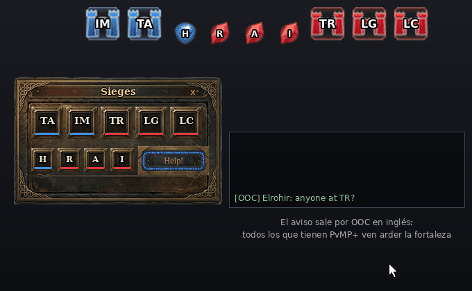

---

## 4. Botón Help!: pedir ayuda con tu posición en el mapa

El botón **Help!** de la ventana de Asedios envía por **OOC** un pedido de ayuda con tu posición. El juego cambia `;loc` por tus coordenadas:

```
HELP! @ Ettenmoors: Glân Vraig: 15.3S, 13.1W
```

**Quien tenga PvMP+ ve:**

1. El aviso en pantalla *"¡Gandalfo pide ayuda!"*.
2. Un **aviso pequeño que se puede pulsar**: *"Clic: ver en el mapa | clic der.: cerrar"*.
3. Al pulsarlo, se abre el **mapa del plugin** con una **marca azul parpadeante** en la posición exacta y el nombre de quien pidió ayuda. La marca dura **90 segundos**.

El mapa no se abre solo: cada jugador decide si quiere verlo. LOTRO no permite que un plugin haga clicable el texto del chat, por eso se usa este aviso.

Las coordenadas se leen bien aunque el otro jugador use el cliente en alemán o francés (coma decimal).

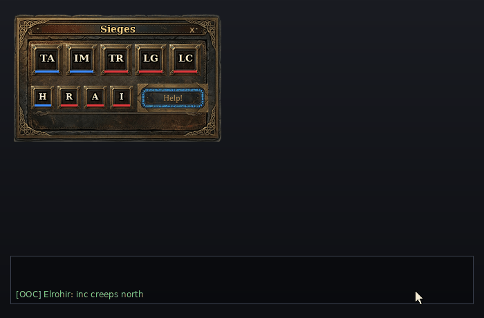

---

## 5. Gaergoth the Unbound: icono con llamas y temporizador

Debajo de la barra hay un **icono grande de Gaergoth**, siempre visible:

| Estado | Cómo se ve |
|---|---|
| **Activo** (no se sabe cuándo muere) | Icono con **llamas animadas en todo su contorno** y el texto **¡ACTIVO!** en naranja |
| **Muerto** | Icono **gris, sin llamas**, cuenta atrás de **1 hora** (*"Reaparece en 59:59"*) y una barrita que se vacía. Los últimos 5 minutos el texto se pone naranja |
| **Fin de la hora** | Vuelven las llamas y avisa *"¡Gaergoth the Unbound está activo!"* |

- **Cómo detecta la muerte:** busca en el chat del juego "Gaergoth" junto con palabras de muerte (*topples*, *has been defeated*, *slain*, *has fallen*…). Ignora lo que escriben los jugadores y los mensajes de cuando Gaergoth te mata a ti.
- **Guardado:** el estado se guarda por servidor, así que sigue contando aunque salgas del juego.
- **Control manual:** `/pvmp+ gaergoth muerto` (o `off`) y `/pvmp+ gaergoth activo` (o `on`).

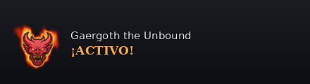

---

## 6. Ventana de estadísticas

Se abre con el botón de estadísticas del panel principal. Tiene 7 pestañas con iconos modernos y 4 estados: normal, ratón encima, seleccionada y seleccionada con ratón encima.

- **Estadísticas del personaje:** rango, nivel (*tier*), totales, máximos por día y mes, renombre por golpe mortal y golpes mortales por muerte.
- **Registro de golpes mortales:** lista de enemigos derribados, con buscador.
- **Gráficas de los últimos 31 días y del último año:** renombre/infamia, menciones, golpes mortales, muertes y rastreos.

---

## 7. Avisos, últimas bajas, golpes recientes y mapa

Todo esto es del PvMP+ original, traducido:

- **Avisos en pantalla**, cada uno se puede activar o desactivar en Opciones:
  - te están rastreando;
  - enemigo en sigilo cerca o descubierto;
  - golpe mortal;
  - cofre de botín;
  - aviso de menciones;
  - recordatorio de tarea de batalla.
- **Últimas 5 bajas:** botón para enviar tu posición o la de los enemigos al chat.
- **Golpes recientes:** lista de jugadores enemigos que te golpearon, con contador y botón para avisar al chat.
- **Mapa de las Landas de Etten:**
  - estado de las fortalezas;
  - tu posición con `/loc`;
  - las llamadas de enemigos que envían otros jugadores con PvMP+;
  - ahora también las marcas azules de **Help!**.

---

## 8. Idioma español / inglés

- **Por defecto en español.** Cámbialo con el botón **Idioma** en Opciones o con `/pvmp+ idioma en` / `/pvmp+ idioma es`. El plugin se recarga solo.
- **Lo que sigue en inglés:** los textos que el juego envía en inglés (mensajes del chat, nombres de fortalezas, mejoras y rangos). El plugin los necesita así para leer el chat.
- **Otros clientes:** en los clientes alemán, francés y ruso se usan sus traducciones originales.

---

## 9. Iconos y gráficos

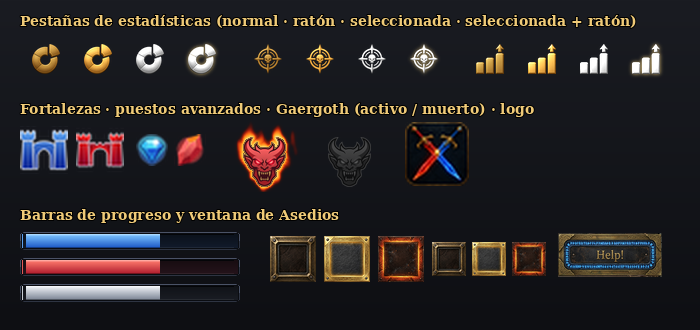

---

## 10. Novedades: barra animada, marcos, temas, rachas y más

Todo se elige en **Opciones** (clic: siguiente opción, clic derecho: anterior) y se guarda por personaje; el tema se guarda para toda la cuenta.

### Barra de rango animada

12 estilos (Brillo deslizante, Energía fluida, Aura pulsante, Punta ardiente, Llamas, Runas élficas, Latido, Neón, Plasma, Destellos, Aurora o Clásica), 10 colores, 3 velocidades, un estilo distinto **en combate**, destello al ganar puntos y aura dorada cuando falta poco para subir de rango.

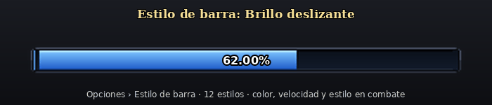

### Marcos de barra y auras

Tres marcos nuevos (**Cristal élfico**, **Metal minimalista**, **Obsidiana de fuego**) con su propio relleno, y auras alrededor de la barra: Pulso, Respiración, Fuego vivo, Escarcha, Arcoíris y Destello viajero. Se combinan con cualquier estilo animado.

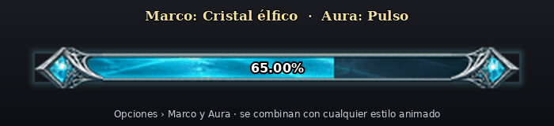

### Temas de color

Clásico, Oscuro moderno, Élfico o Mordor: cambian textos, bordes, paneles, el marco de la barra y el fondo de la ventana de Asedios. También se pueden **bloquear las ventanas** para no moverlas sin querer.

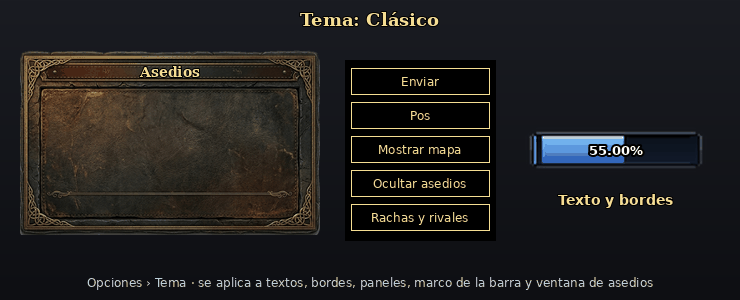

### Rachas y rivales

Aviso en pantalla con cada racha de bajas (3, 5, 10…), tu mejor racha, quién te ha matado más y a quién has matado más. Botón **Rachas y rivales** en la ventana secundaria o `/pvmp+ rivales`.

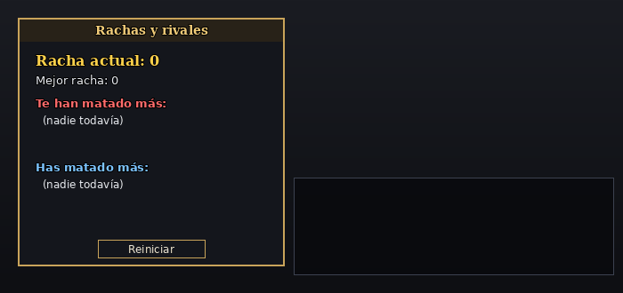

### Marcas del mapa con cuenta atrás

Las marcas de enemigos y de Help! muestran quién avisa y los segundos que les quedan, y se van apagando al final.

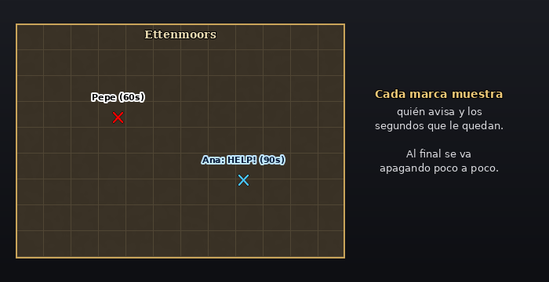

### Gaergoth: aviso 5 minutos antes

Además del temporizador, avisa en pantalla y en el chat cuando faltan 5 minutos para que reaparezca. Su icono se puede poner debajo, a la izquierda o a la derecha de la barra.

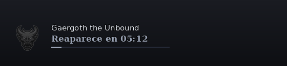

---

## Comandos del chat

| Comando | Qué hace |
|---|---|
| `/pvmp+ opciones` (o `settings`, `ajustes`) | Abre las opciones |
| `/pvmp+ mapa` (o `map`) | Muestra u oculta el mapa |
| `/pvmp+ asedios` (o `sieges`) | Muestra u oculta la ventana de Asedios |
| `/pvmp+ gaergoth muerto` (o `off`, `gaergoth`) | Marca a Gaergoth como muerto y empieza la hora |
| `/pvmp+ gaergoth activo` (o `on`) | Vuelve a poner a Gaergoth como activo |
| `/pvmp+ gaergoth abajo` / `izquierda` / `derecha` | Dónde va el icono de Gaergoth respecto a la barra |
| `/pvmp+ rivales` (o `racha`) | Muestra u oculta la ventana de Rachas y rivales |
| `/pvmp+ auras on` / `/pvmp+ auras off` | Enciende o apaga las auras de los iconos |
| `/pvmp+ idioma es` / `/pvmp+ language en` | Cambia el idioma de la interfaz |
| `/pvmp+` | Muestra la ayuda |

---

## Opciones y guardado

| Qué | Dónde se guarda |
|---|---|
| Estadísticas, posiciones de ventanas, opciones, ventana de Asedios visible u oculta | Por **personaje** (`PvMP_Plus`, con copia `PvMP_Plus_Backup` y copia diaria `PvMP_Plus_Daily_Backup`) |
| Menciones | Por **servidor** |
| Temporizador de Gaergoth | Por **servidor** (`PvMP_Plus_Gaergoth`) |
| Idioma | Por **cuenta** (`PvMP_Plus_Language`) |
| Auras encendidas o apagadas | Por **cuenta** (`PvMP_Plus_Auras`) |

Los datos de versiones anteriores de PvMP+ se siguen leyendo: los nombres de guardado no cambiaron.

---

## Instalación

1. Copia la carpeta **completa** `PvMP_Plus_Revisited` en:
   `Documentos\The Lord of the Rings Online\Plugins\`
2. Debe quedar así (los `.plugin` van en la raíz de `PvMP_Plus_Revisited`):

   ```
   Plugins\
   └─ PvMP_Plus_Revisited\
      ├─ PvMP+.plugin
      ├─ PvMP+Reloader.plugin
      ├─ README.md
      ├─ media\
      └─ PvMP_Plus\        (código, textos e imágenes)
   ```

3. En el juego escribe `/plugins refresh` y carga **PvMP+** desde el gestor de plugins, o con `/plugins load PvMP+`.
4. La primera vez te pedirá tu total de renombre/infamia y de golpes mortales, para que las cuentas empiecen bien.

> Si tenías una instalación vieja con `PvMP+.plugin` dentro de `PvMP_Plus_Revisited\PvMP_Plus\`, borra esos dos `.plugin` viejos para que el juego no muestre el plugin repetido.

---

## Requisitos, limitaciones y créditos

**Requisitos**

- *The Lord of the Rings Online* con plugins Lua activados.
- Personaje en las Landas de Etten, de los Pueblos Libres o de los Monstruos.

**Limitaciones conocidas**

- **Asedios y Help!** solo los ven los jugadores que también tienen **PvMP+ Revisited** instalado. Los demás leen el mensaje normal en OOC.
- **Mensaje de Gaergoth:** el texto exacto que da el juego al morir Gaergoth no está documentado. Si un día no se detecta, usa `/pvmp+ gaergoth muerto`.
- **Chat no clicable:** LOTRO no permite hacer clicable el texto del chat desde un plugin; por eso Help! usa un aviso pulsable.

**Créditos**

- **PvMP+** original: **Urundus**. Traducción alemana: RenthoMar.
- **PvMP+ Revisited**: versión en español con correcciones, aspecto moderno, auras, ventana de Asedios, Help! y temporizador de Gaergoth, por **sharshazo**.
- Se respetan los créditos y el trabajo del autor original.


## Actualización del 18 de octubre de 2026

El guardado no modifica temporalmente la geometría viva; se agrupan las solicitudes próximas y se conservan respaldos. Calendario y resumen independientes de la disponibilidad de la moneda, y consulta de mochila con caché. Persisten tres condiciones pendientes descritas en la comprobación general.

Las comprobaciones automatizadas no certifican ausencia total de errores ni todas las interacciones dentro de LOTRO.
